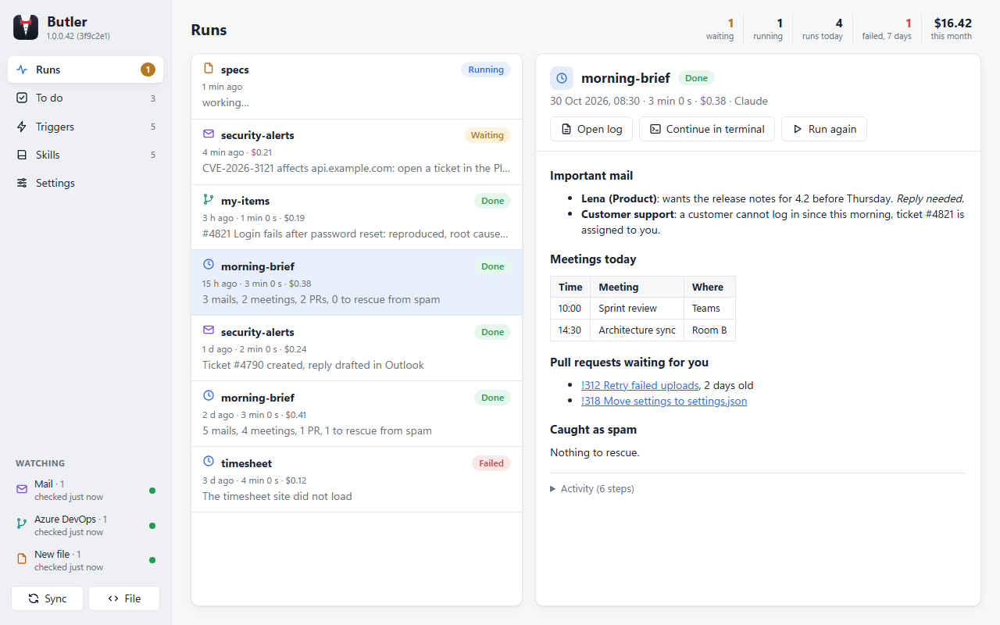
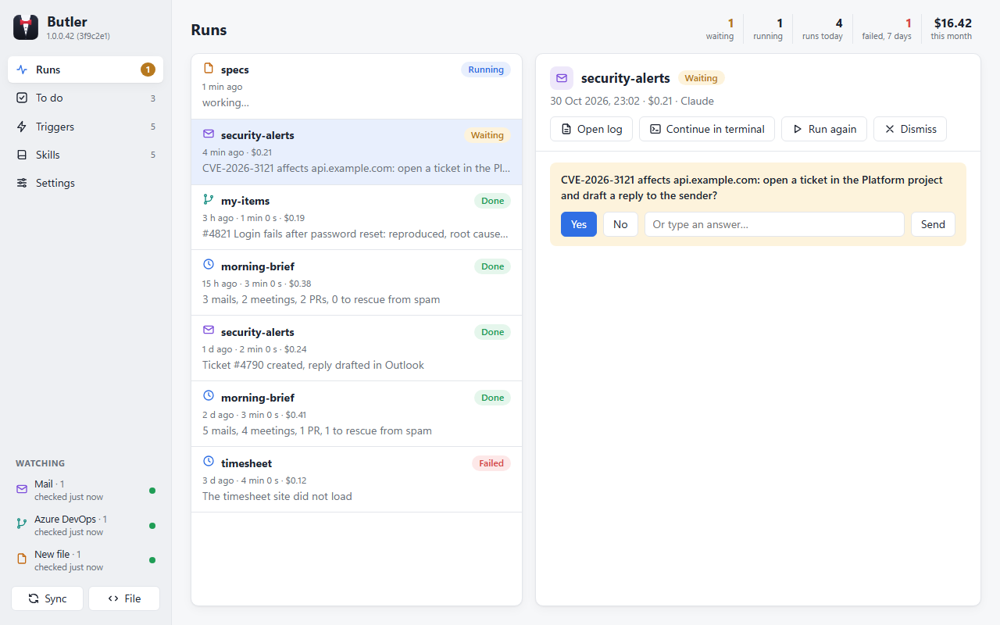
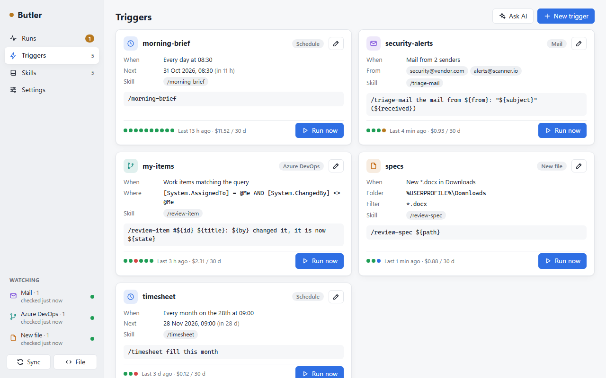
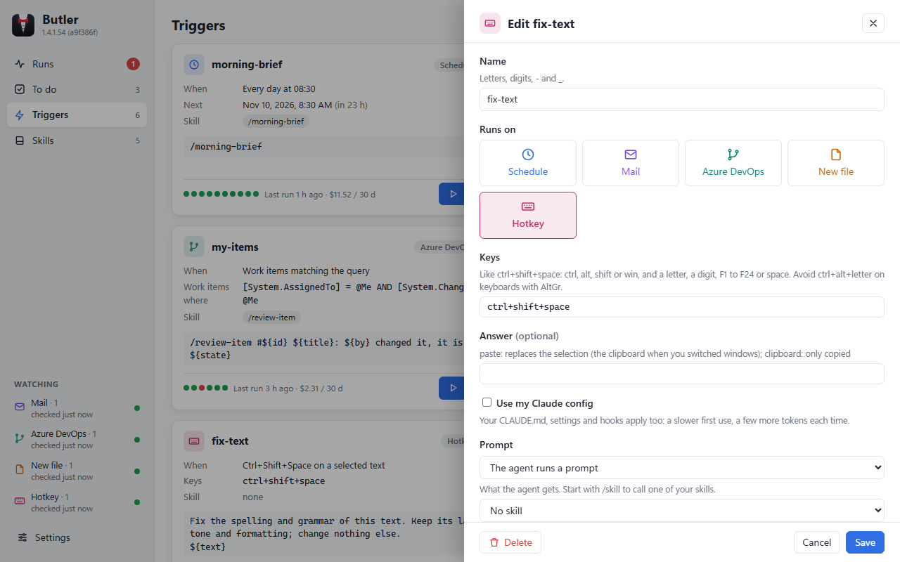
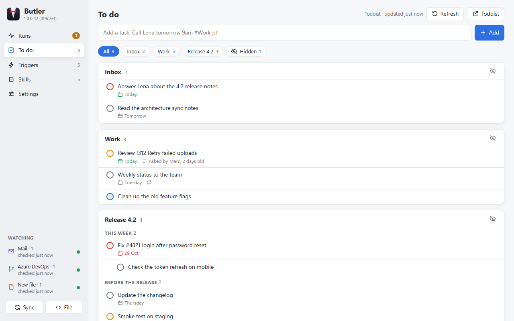

<div align="center">


# Butler

### Your AI agent, working while you don't.

Butler runs **Claude Code** or **GitHub Copilot CLI** for you, at the right moment: every morning, when a mail
arrives, when a work item changes, when a file lands in a folder, when you press a shortcut on a selected text.
It tells you what it did, and asks when it needs you.

[](https://github.com/o0Zz/butler/actions/workflows/ci.yml)
[](https://github.com/o0Zz/butler/releases)


[](LICENSE)

[**Download**](https://github.com/o0Zz/butler/releases) · [Why Butler](#why-butler) · [What you get](#what-you-get) · [Triggers](#triggers) · [Get started](#get-started) · [How it works](#how-it-works)



</div>

## Why Butler

You already have an agent that can read your mails, review a pull request, fill a timesheet or turn a security
alert into a ticket. You probably wrote the skills for it. But it only works when **you** open a terminal and ask.

**Butler starts it for you.** No window open, no prompt to remember: the brief is ready when you sit down, the
alert is triaged before you read it, the spec is reviewed as soon as it lands in your Downloads.

- ⏰ **Runs on events, not on your memory.** A schedule, a mail from a given sender, an Azure DevOps change, a new
  file: each one starts your agent, headless, with the prompt you chose.
- ⌨️ **One shortcut away, in any app.** Select a text, press your keys, and the agent's answer replaces it in place.
- 🛟 **Nothing gets lost.** Schedules catch up after sleep. Mails, work items and files are read from a checkpoint,
  so what arrived while your PC was off is handled when it wakes up.
- 🙋 **Asks instead of guessing.** A run can stop with a question. You answer from a notification, in one click,
  and the same agent session carries on.
- 🔍 **You see everything.** Every run, what started it, each step of the agent, the outcome, the duration, the cost.
- 🔒 **Yours, and only yours.** Triggers are a plain JSON file next to your skills, in your own git repo. No server,
  no account, no telemetry: Butler drives the CLI you already use, with your own login.

## What you get

### A morning brief before you sit down

A trigger at 08:30 runs your `/morning-brief` skill: the mails that matter, today's meetings, the pull requests
waiting for your vote, the mails wrongly caught as spam. The summary waits in the dashboard and in a notification,
in clean Markdown, with the cost of the run.

### It asks, you answer in one click

When the agent needs a decision, the run stops with a question instead of guessing. Answer **Yes**, **No** or a
sentence, from the dashboard or straight from the notification on Windows, and the same session goes on.

<div align="center">

</div>

### Fix a sentence anywhere with a shortcut

Select a text in any app (mail, chat, editor), press **Ctrl+Shift+Space**, and the corrected text replaces it. A
small "working…" label by the pointer shows it is on it. Each shortcut has its own prompt: one fixes the spelling,
another translates, another turns notes into a polite mail. With Claude Code, Butler keeps the agent ready after the
first use, so an answer takes about a second. Windows only.

### Triggers you can read at a glance

One card per trigger: when it fires, what it calls, its next run, its last ten results and what it cost over 30
days. **Run now** tries it immediately; type anywhere on the page to search the triggers (or the skills). On the Skills
page, **Run** opens your agent in a terminal with the skill started, and leaves it open for you to follow up. The
**Watching** panel tells you when a source is down (Outlook closed, a folder gone) instead of failing in silence.

<div align="center">

</div>

### Add a trigger in a few clicks

Pick what starts it: a **schedule** (built from menus), a **mail** from given senders, an **Azure DevOps** query,
a **new file** in a folder, or a **hotkey**. Pick a skill, click the variables to insert (`${subject}`, `${path}`...),
and a model: **fast**, **balanced** or **powerful**, which Settings maps to a model of your CLI (Haiku, Sonnet, Opus
by default). Butler checks everything before saving. Prefer words? **Ask AI** opens your agent in your skills folder:
Butler keeps a `butler` skill there that teaches any agent session how to write triggers.

<div align="center">

</div>

### Your to-do list, next to your agent

The **To do** page shows your **Todoist** list (or a plain **todo.txt** file): click a task to edit it, drag it by
its handle to reorder, click between two tasks to add one right there, check it off with undo. Hide the lists you
don't want at work. Your agents reach the same list through their own tools, so a run can add the follow-up it found.

<div align="center">

</div>

## Triggers

Triggers live in a JSON file (by default `~/.claude/skills/butler.json`), edited from the dashboard or by hand:

```json
[
  { "name": "morning-brief", "on": "schedule", "schedule": "daily 08:30", "prompt": "/morning-brief" },
  { "name": "timesheet", "on": "schedule", "schedule": "monthly:28 09:00", "prompt": "/timesheet" },
  { "name": "security-alerts", "on": "mail", "from": ["security@vendor.com"], "prompt": "/triage-mail ${from} ${subject}" },
  { "name": "my-items", "on": "ado", "where": "[System.AssignedTo] = @Me AND [System.ChangedBy] <> @Me", "prompt": "/review-item #${id} ${title}" },
  { "name": "specs", "on": "file", "folder": "%USERPROFILE%\\Downloads", "filter": "*.docx", "prompt": "/review-spec ${path}", "model": "powerful" },
  { "name": "fix-text", "on": "hotkey", "keys": "ctrl+shift+space", "model": "fast", "prompt": "Fix the spelling and grammar of this text, change nothing else.\n${text}" }
]
```

| `on` | Fires | Variables |
|---|---|---|
| `schedule` | `daily HH:mm`; days of the week: `fri HH:mm`, `mon-fri HH:mm` (weekdays), `mon,wed,fri HH:mm`; `monthly:28 HH:mm`; a time missed while Butler was closed or the PC off runs at the next start, once | none |
| `mail` | a mail from one of the `from` addresses, in any folder of Outlook classic (checked every 30 s) | `${from}` `${subject}` `${received}` |
| `ado` | a work item created or changed that matches the `where` WIQL condition (checked every 2 min) | `${id}` `${title}` `${state}` `${by}` |
| `file` | a new file in `folder`, optionally matching `filter`, once fully written | `${path}` `${name}` |
| `hotkey` | `keys` pressed on a selected text in any app (Windows); the answer replaces the selection, or goes to the clipboard with `"output": "clipboard"`; `"myConfig": true` loads your own Claude config (CLAUDE.md, hooks) | `${text}` |

A prompt starting with `/skill` calls that skill. `model` is a level (`fast`, `balanced`, `powerful`, set per CLI in
Settings) or a model name; without it, the CLI's default. After editing the file by hand, `Butler.exe check | more`
tells you what Butler would refuse. A trigger can run a `command` instead of a `prompt`, with no agent
(`cmd` on Windows, `sh` elsewhere): `{ "name": "pull", "on": "schedule", "schedule": "daily 08:00", "command": "git -C %USERPROFILE%\\.claude\\skills pull" }`.
It gets the event in environment variables (`BUTLER_PATH`, `BUTLER_SUBJECT`...): write `!BUTLER_PATH!` with cmd, `"$BUTLER_PATH"` with sh.

Butler only reads your mailbox: it never sends, moves or deletes a mail itself (your skills can prepare drafts).

## Get started

1. **Download** `Butler-x.y.z.exe` (Windows), `Butler-x.y.z-osx-arm64` or `Butler-x.y.z-linux-x64` from the latest
   [release](https://github.com/o0Zz/butler/releases), put it where you like (e.g. `%LOCALAPPDATA%\Programs\Butler`)
   and run it (on macOS and Linux, `chmod +x` it first). One file.
2. Open the dashboard from the tray icon and go to **Settings**: choose your agent CLI, your triggers file and your
   skills folder (and your to-do list if you want one). The dashboard speaks English or French, following your system by default.
3. Add your first trigger, and press **Run now** to see it work.

Butler checks for a new version once a day; **Settings › Check for updates** does it now, and **Install and
restart** replaces the exe in place.

Requirements:
- Windows 10 or 11 (x64) with the WebView2 runtime (built into Windows 11) and the [.NET 9 Desktop Runtime](https://dotnet.microsoft.com/download/dotnet/9.0);
  macOS (Apple silicon) or Linux (x64) with the [.NET 9 Runtime](https://dotnet.microsoft.com/download/dotnet/9.0).
  On Linux, WebKitGTK 4.1 for the dashboard (`sudo apt install libwebkit2gtk-4.1-0`), and optionally `notify-send`
  (`libnotify-bin`) for notifications and `secret-tool` (`libsecret-tools`) with a running keyring for the Todoist token.
- An agent CLI, logged in: [Claude Code](https://docs.claude.com/en/docs/claude-code) (`claude`) or
  [GitHub Copilot CLI](https://github.com/features/copilot/cli) (`copilot`).
- For mail triggers: Outlook classic, running (Windows only). For Azure DevOps triggers: the
  [Azure CLI](https://learn.microsoft.com/cli/azure/) with the `azure-devops` extension, logged in (`az login`).

## How it works

- A tray app (.NET 9, Avalonia) with a web dashboard in the system's web view (WebView2, WebKit).
- Each run is a separate `Butler.exe run <trigger>` process that starts the agent headless
  (`claude -p` or `copilot -p`), records its stream and its outcome, and shows a notification. Hotkey runs are the
  exception: the tray keeps one Claude Code running after the first press (no tools, cleared after each prompt) and
  closes it when Butler exits.
- Triggers are polled by the tray from checkpoints stored in `%LOCALAPPDATA%\Butler`,
  together with the settings and the run history. Secrets (the Todoist token) go to the OS's secret store (Credential Manager, Keychain, libsecret).
- Optionally, a daily zip of your skills, triggers and settings goes to a folder of your choice (a Google Drive or OneDrive folder takes it off the PC).
- A small protocol lets a run end with a question (`BUTLER-ASK`) or a one-line outcome (`BUTLER-SUMMARY`); an
  answer resumes the same agent session.

[`CLAUDE.md`](CLAUDE.md) describes the architecture and the design decisions in detail.

## Development

```sh
git clone https://github.com/o0Zz/butler.git
cd butler
dotnet build
dotnet test
src/Butler/bin/Debug/net9.0-windows10.0.17763.0/Butler.exe
```

Building needs the [.NET 9 SDK](https://dotnet.microsoft.com/download). The tests run against the real things:
folders, the OS's secret store, and Outlook or Azure DevOps when they are available.

Versions are `X.Y.Z.N`, N being the number of commits: `0.0.0.N` for any build, `1.0.0.N` for the tag `v1.0.0`.
[CI](.github/workflows/ci.yml) builds and tests every push and pull request; pushing a tag also publishes the
exe as a GitHub release:

```sh
git tag v1.0.0
git push origin v1.0.0
```

## License

[Apache License 2.0](LICENSE)
